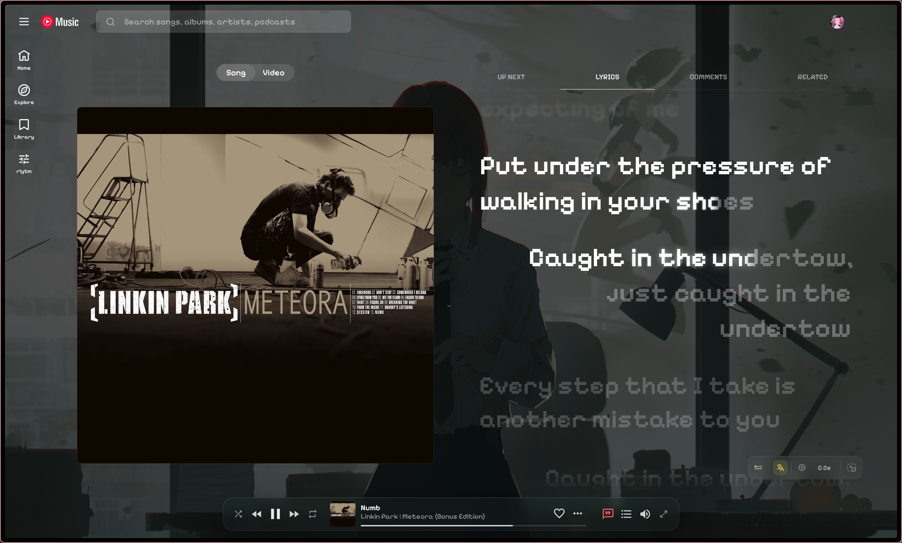
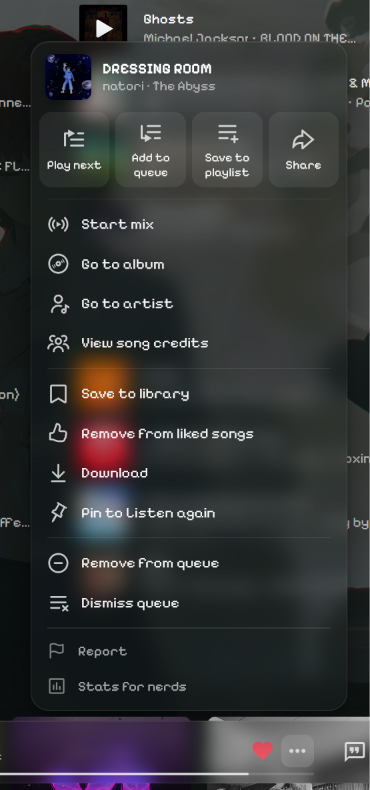
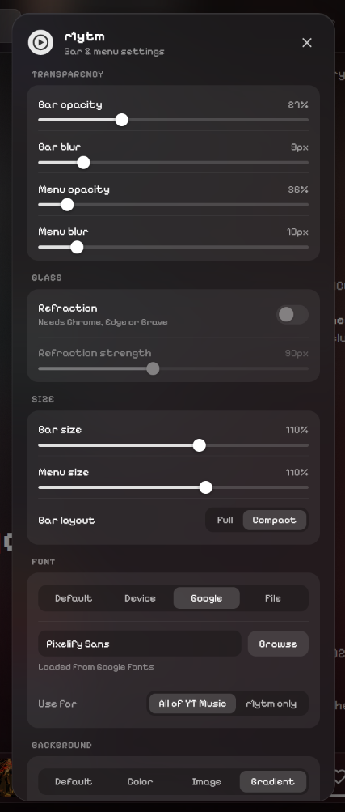
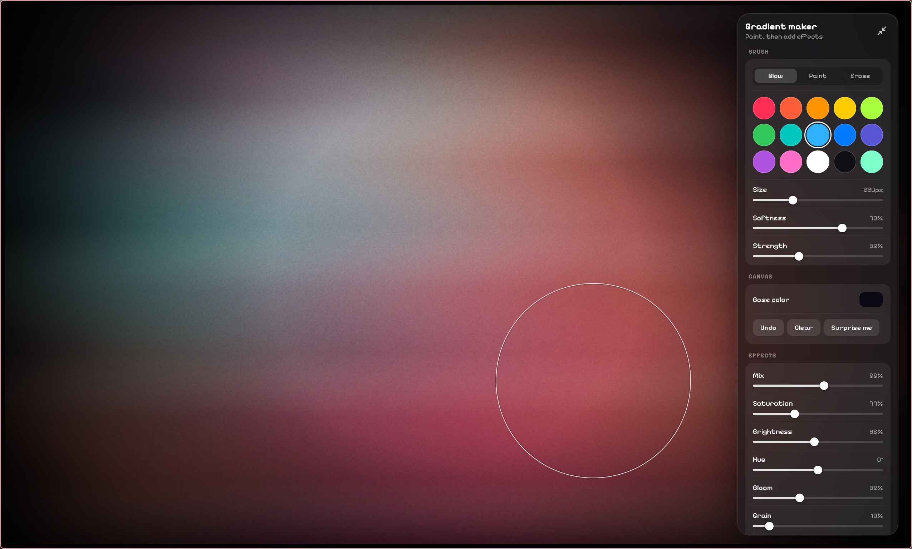
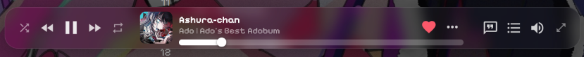
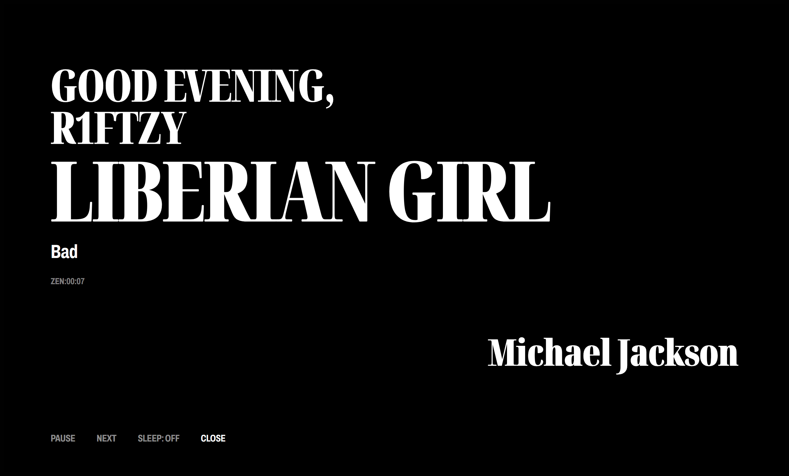

# r1ytm: Cool Modernized YouTube Music I guess

**Now more than just** A floating, Apple Music style control bar for YouTube Music. Unofficial, and not affiliated with Google LLC or Apple Inc.

<p align="center">
  
  
  <br><b>Custom background</b> behind the whole app &nbsp;·&nbsp; <b>Menu</b>: one popup for every 3-dot menu
</p>

<p align="center">
  
  
  <br><b>Settings</b>: glass, size, font and background &nbsp;·&nbsp; <b>Gradient maker</b>: paint light, then add effects
</p>

<p align="center">
  
  <br><b>The bar</b>: Usable ahh progress bar (on hover).
</p>

<p align="center">
  
  <br><b>Zen mode</b>: You can (not) stay focused.
</p>

Runs only on `https://music.youtube.com/*`. Needs no permissions. Works in Chrome (and Edge/Brave) and Firefox 140+.

## Features

- A floating bar replaces YouTube Music's player bar, with playback, like, volume, lyrics and queue. Click it to open the player.
- Every 3-dot menu and right-click opens in one cleaner popup.
- You can change how see-through and blurred the bar and menus are, and turn on refraction in Chrome-based browsers.
- You can use any font from your device, from Google Fonts or from a font file.
- You can set your own background: a color, an image or GIF, or a gradient you make yourself!
- The gradient maker lets you paint with soft glowing brushes and add effects like grain, bloom and glass.
- Zen mode locks the music for a time you pick (or no limit): a black title-card screen with only play / pause, next, a sleep timer and a close button that unlocks when the time is up.
- With [Better Lyrics](https://github.com/better-lyrics/better-lyrics) installed, zen mode can show the line being sung (or two lines), at the bottom or under the title, with a hard cut or a smooth slide.
- You can set up zen mode in the settings: the layout, the fonts, which parts show, and what each line ends with.
- The settings come in two layouts: Modern (categories on the side) or Legacy (one long list).

It is best used together with [Better Lyrics](https://github.com/better-lyrics/better-lyrics) for YouTube Music.

You find all the settings under **r1ytm** in the YouTube Music sidebar.

## Install

### Firefox (extension)

Install it from [Firefox Add-ons](https://addons.mozilla.org/en-US/firefox/addon/r1ytm/) and click **Add to Firefox**. Needs Firefox 140 or newer (also works on Firefox for Android 142+).

### Developer mode (Chrome, Edge, Brave, or Firefox)

Get the code (`git clone` or **Code > Download ZIP** on GitHub). The `extension` folder loads as it is.

**Chrome / Edge / Brave** (version 111 or newer):

1. Open `chrome://extensions` (Edge: `edge://extensions`).
2. Turn on **Developer mode**.
3. Click **Load unpacked** and pick the `extension` folder.

**Firefox** (version 140 or newer):

1. Open `about:debugging#/runtime/this-firefox`.
2. Click **Load Temporary Add-on** and pick `extension/manifest.json`.
3. Firefox removes a temporary add-on when it closes, so repeat this after each restart. For a permanent install, use the Firefox Add-ons link above.

After you update the code, click **Reload** on the extension.

### Userscript (Any browser)

1. Install [Tampermonkey](https://www.tampermonkey.net/) (or Violentmonkey).
2. Open **[r1ytm.user.js](https://raw.githubusercontent.com/R1ftzy/r1ytm-player/main/r1ytm.user.js)**. Tampermonkey shows its install page: click **Install**.

Tampermonkey checks that link for updates, so new versions arrive on their own. You can also read the code first: [r1ytm.user.js](r1ytm.user.js).

## Editing the code

The source is in `src/`, one file per part of the script. Do not edit `extension/content.js` or `r1ytm.user.js`: they are generated.

1. Edit the files in `src/`.
2. Run `node build.mjs` (needs Node.js, no packages). It joins the `src/` files into `extension/content.js` and `r1ytm.user.js`.
3. Run `node build.mjs --check` to make sure nothing is out of date before a commit.

The `src/` files are joined in the order listed in `build.mjs` and share one scope, so a new file must be added to its `SECTIONS` list.

## Sign and install your own build (Firefox)

Release Firefox only installs signed add-ons. To sign your own copy:

1. Create API keys at [addons.mozilla.org/developers/addon/api/key](https://addons.mozilla.org/en-US/developers/addon/api/key/) (needs a free Firefox account).
2. Sign it as an unlisted add-on (needs Node.js):

   ```bash
   npx web-ext sign --channel=unlisted \
     --source-dir extension \
     --api-key=<JWT issuer> --api-secret=<JWT secret>
   ```

3. Take the signed `.xpi` from `web-ext-artifacts/`.
4. Install it: drag the `.xpi` into Firefox, or open `about:addons`, click the gear, choose **Install Add-on From File** and pick the file.

Each signing needs a new `version` in `extension/manifest.json`. AMO rejects a version it has already seen.
