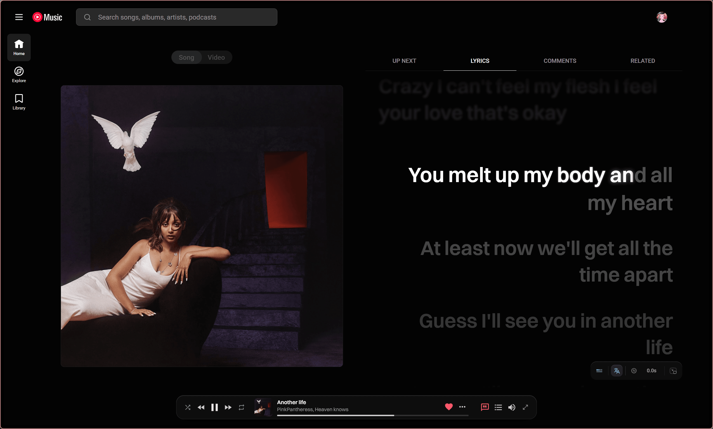

# r1ytm

A floating, Apple Music style control bar for YouTube Music. Unofficial, and not affiliated with Google LLC or Apple Inc.



Runs only on `https://music.youtube.com/*`. Needs no permissions. Plays nicely with the [Better Lyrics](https://github.com/better-lyrics/better-lyrics) extension. Works in Chrome (and Edge/Brave) and Firefox 140+.

## Build

Windows:

```powershell
pwsh -File extension/build.ps1
```

Linux / macOS (needs `zip`):

```bash
./extension/build.sh
```

Output goes to `dist/` (chrome and firefox folders plus zips). Load `dist/r1ytm-chrome` unpacked in Chrome, or `dist/r1ytm-firefox/manifest.json` via `about:debugging`.
